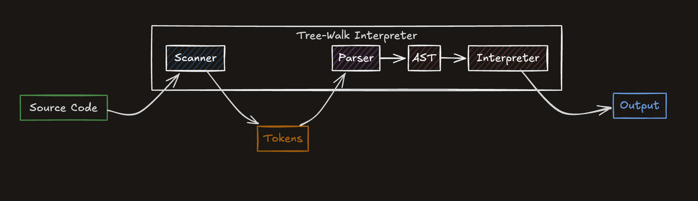

# go-lox

a personal go implementation of the lox interpreter from crafting interpreters by robert nystrom.

<div align="center">
  
  <br>
  <em>current progress on what I've learnt so far</em>
</div>

built for learning, not for production.

current read: **_chapter 11_**

_a peak interest in practicing go whilst revisiting the concepts of compilers and interpreters_

## what works so far

- **scanning** - tokenizes lox source into tokens (strings, numbers, keywords, operators)
- **parsing** - recursive descent parser that builds an AST from tokens
- **evaluating** - tree-walk interpreter that executes the AST
- **variables** - `var` declarations, assignment, block scoping with `{ }`
- **control flow** - `if`/`else`, `while`, `for` loops, logical `and`/`or`
- **functions** - first-class functions, closures, recursion, `return`
- **static analysis** - resolver pass for correct scope binding + compile-time error detection
- **native functions** - `clock()` bridging go to lox
- **extras** - `%` modulo operator, comma expressions

## try it

```bash
# run a file
go run main.go test/phase4.lox

# or the repl
go run main.go
```

## what's next

- classes and inheritance (chapters 12-13)
- test suite
- language extensions (arrays, lambdas, string methods)
- stdlib (file i/o, http, json)
